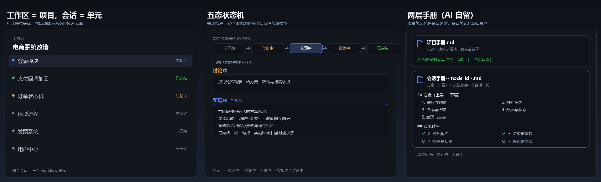

# dsh-agent-workflow —— Agent 编排与 Workflow 状态机插件



> 给 [DeepSeek Harness](https://github.com/deepseek-ai/deepseek-harness) 的桌面版插件：**工作区 = 一个项目，会话 = 一个 workflow 单元**。每个会话走**五态状态机**（讨论 → 实现 → 验收），当前状态自动决定注入给模型的操作细节，并把项目的方案、决策、要点沉淀进**两层手册**（项目手册 + 会话手册）。

- **仓库地址**：<https://github.com/InvisibleZero/dsh-agent-workflow>
- **版本**：`0.2.0`
- **验证环境**：DSH `0.2.2-rc.1`（Windows 桌面版）
- **开发手册**：[DEVELOPMENT.md](./DEVELOPMENT.md)（构建命令、宿主契约速查、踩坑清单 D-01 起）

---

## 它解决什么问题

DSH 原生是「工作区 → 会话」，会话之间没有流程、没有共享记忆。这个插件给每个会话装上一个**有纪律的工作流**：

- **会话即单元**：打开一个会话，它自动成为 workflow 节点，开始走状态机；
- **状态驱动上下文**：讨论中 / 实现中 / 验收中，模型看到的操作规范和记录要求不一样；
- **两层记忆**：项目级（总览/决策/要点）跨会话延续，会话级（方案/实施顺序）各自独立；
- **AI 自留记录**：方案、实施进度、决策都由 AI 自己写进手册，人只读。

---

## 功能

### 1. 会话即项目单元（自动认领）

不需要任何"新建 workflow"的入口——**打开任意会话，它自动成为 workflow 节点**，输入框工具条里出现状态徽标。会话按它所在的工作目录自动归属到对应的项目（工作区）。

### 2. 五态状态机 + 返工

```
未开始 ──▶ 讨论中 ──▶ 实现中 ──▶ 验收中 ──▶ 已完结
              ▲          ▲          │
              └──────────┴──────────┘  返工（退回上一阶段）
```

- 返工是**条件流转**：实现中可以退回讨论中（方案要改）；验收中可以退回实现中（小问题修补）或讨论中（方案错）。

### 3. 会话里的状态徽标

权限控件右侧的状态胶囊（如「● 实现中」）：

- 点它 → 打开节点弹窗（会话手册 / 项目手册 / 补充说明 / 时间线）；
- 右边的 `→` → 推进到下一状态；
- 可返工时出现 `↩` → 选择退回哪个阶段；
- 实现中还会出现「实施 n/m」胶囊，点开看实施顺序的勾选进度（AI 勾、只读）；
- 推进成功后，把新状态的**默认输入**填进输入框（不自动发送）。

### 4. 操作细节 A / B / C / D（应用级全局）

设置 → **Agent 工作流**：

- **A 公共**：三态通用，每个节点都读；
- **B/C/D**：讨论中 / 实现中 / 验收中各自的专属细节 + 进入后默认输入；
- 改动 **700ms 自动保存**，没有保存按钮。

### 5. 节点级附加说明

节点弹窗里可以给**某个会话**加一段补充（全局 / 讨论中 / 实现中 / 验收中），纯增量、不覆盖全局。

### 6. 按状态注入上下文

通过 `systemPrompt.context()` 注入，每次装配重新求值、不写进聊天记录：

```
节点 / workflow / 当前状态
A（公共）+ 当前状态的 B/C/D
本节点附加说明
会话手册（方案 + 实施顺序，最近 2000 字 + 文件路径）
项目手册（总览 / 决策 / 要点，≤800 字）
收尾提示：结论写进项目手册要点/决策，同步会话手册方案/实施顺序
```

### 7. 两层手册 + 实施清单（AI 自留）

所有手册平铺在工作区根目录的 `.workflow/` 下：

```
<你的工作区>/.workflow/
  项目手册.md            ← 项目总览 / 决策 / 要点（每工作区一份，跨会话延续）
  会话手册-<node_id>.md   ← 方案（5 层）+ 实施顺序（每会话一份，AI 自己勾）
```

- 讨论中把已确认方案按「目标与验收 → 对外契约 → 结构与依赖 → 数据与状态 → 表现与文案」写进会话手册；
- 实现中按「实施顺序」逐层落地，每完成一层勾掉，等「继续」再下一层；
- 项目手册由各会话在收尾时回写结论，是跨会话的共享记忆；
- `.gitignore` 若存在，自动补一行 `.workflow/`。

### 8. 状态时间线

每次状态迁移记一条（时间 + 从哪来 + 到哪去），节点弹窗里可回看这个会话是怎么一步步走到现在的。

---

## 安装

### 方式一：从 GitHub 安装（推荐）

```bash
# 1. 进入你的 DSH profile（默认叫 desktop）
cd ~/.dsh/profiles/desktop

# 2. 安装（用 DSH 自带的 pnpm，或系统 pnpm）
pnpm add github:InvisibleZero/dsh-agent-workflow#main
```

然后确认该目录下的 `package.json` 里，`dsh.profile.bundles` 数组包含 `"dsh-agent-workflow"`（pnpm 不会自动加，需要手动补）：

```json
{
  "dsh": {
    "profile": {
      "bundles": [
        "@deepseek-ai/dsh-base",
        "@deepseek-ai/dsh-web-app",
        "dsh-agent-workflow"
      ]
    }
  }
}
```

### 方式二：本地开发（link 到源码目录）

```bash
# 1. 先构建出 dist（插件入口是 dist/host.js 与 dist/client-bundle.js）
cd <仓库目录>
pnpm install --node-linker=hoisted
pnpm build

# 2. link 进 profile
cd ~/.dsh/profiles/desktop
pnpm add link:<仓库绝对路径>
```

同样把 `"dsh-agent-workflow"` 加进 `dsh.profile.bundles`。

### 安装后怎么生效

| 改了什么 | 怎么生效 |
| --- | --- |
| 宿主半（`dist/host.js`、路由、注入逻辑） | 插件页把它**关一次再开**，或重启 DSH |
| 客户端半（`dist/client-bundle.js`、界面） | 页面 **Ctrl+Shift+R** 硬刷新 |
| 只改设置里的文案 | 立即生效 |

插件声明了两半：

- 宿主半：`package.json` 的 `dsh.bundle.patch` → `cordis.patch.yml`，自动插入 `id: dsh-agent-workflow`；
- 客户端半：`dsh.client` 声明 + `exports["./client"]` 指向 `dist/client-bundle.js`。

---

## 仓库开发

```bash
pnpm install --node-linker=hoisted   # 本环境沙箱需要平铺 node_modules
pnpm build                           # tsc 宿主 → esbuild 单文件 → tsc 客户端 → 打客户端包
pnpm smoke                           # 客户端冒烟：槽位注册是否正常
pnpm typecheck                       # 只做类型检查
```

构建产物：

- `dist/host.js`：宿主半单文件（ESM）
- `dist/client-bundle.js`：客户端半单文件（lazy-CJS，由 `window.__ModuleLoader__` 加载）

---

## 目录结构

```
src/
├── host.ts                    # 宿主半入口：HTTP 路由（ensure-node/transition/node-manual/…）
├── host/
│   ├── workflow-repository.ts # workflow 快照、节点（会话）、两层手册读写
│   └── workflow-state-context.ts # 按状态注入上下文（systemPrompt.context）
├── schema/                    # 数据模型（Zod）：node / node-state / workflow / …
├── engine/                    # 纯逻辑，零框架依赖：状态机 / 聚合 / 熔断 / 故障路由
├── adapter/                   # 端口与实现：json-storage（原子写）/ port / dsh-runtime
├── service/                   # 面向 agent 的 workflow 工具
└── client/                    # 浏览器半
    ├── dsh-plugin.tsx         # 客户端入口（注册槽位）
    ├── workflow-embedded.tsx  # 会话状态徽标（状态/推进/返工/实施清单）
    ├── workflow-dialogs.tsx   # 操作细节设置页 + 节点弹窗（手册/时间线）
    └── menu-util.ts           # Menu 定位原语
```

---

## 已知限制

- **手册隔离是「约定级」**：所有会话的工作目录都是工作区根，模型技术上能读到别人的 `.workflow/*.md`，只靠注入内容与提示语约束；
- **项目手册并发写**：多会话共享项目手册，后写覆盖先写（单人顺序使用时基本无感）；
- **删工作区是软删除**：只删「工作区记录 + workflow 快照」，文件夹、会话日志、`.workflow/` 笔记都留在磁盘上；
- **自动认领依赖会话 cwd**：会话的工作目录必须能定位到工作区，否则徽标不出现；
- **手册由 AI 自留，人只读**：节点弹窗只展示、不提供编辑入口。

---

## 相关文档

- [DEVELOPMENT.md](./DEVELOPMENT.md)：构建命令、宿主契约速查、踩坑清单（D-01 起）
- [HANDOFF.md](./HANDOFF.md)：交接说明
- [SPIKE.md](./SPIKE.md)：最初的技术验证记录
